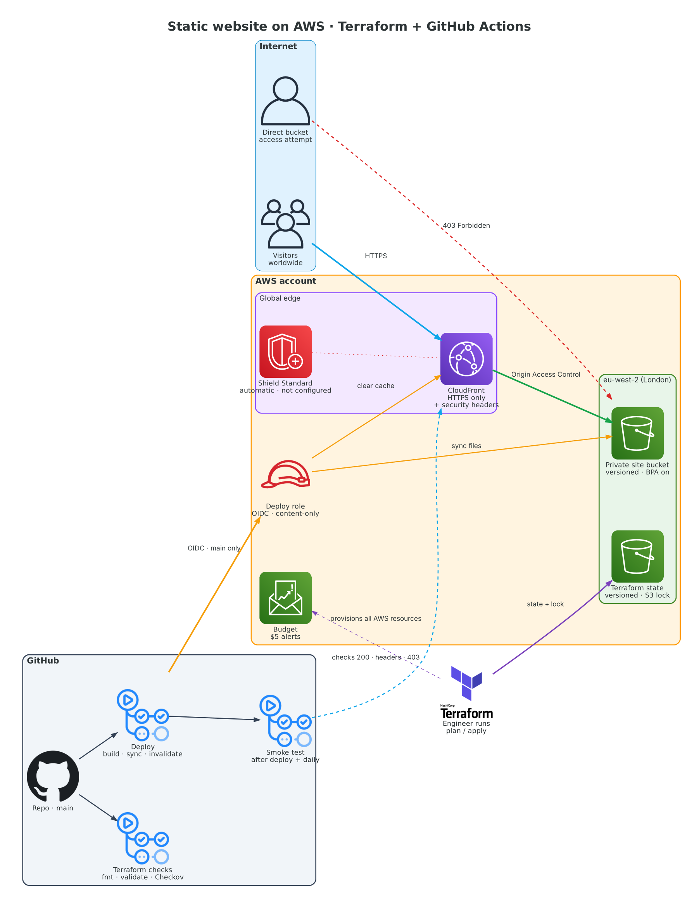

# Static Website on AWS with Terraform

A client's single-page Next.js portfolio, hosted on a private S3 bucket behind CloudFront and built entirely with Terraform. Deploys run through GitHub Actions with no stored AWS keys, every change is checked for security issues before it reaches `main`, and the live site is tested after every deploy and every morning.

**Live site:** https://d2v841qmb3715d.cloudfront.net
*(This is the default CloudFront domain, so it changes whenever the stack is rebuilt. See [Disaster recovery](#disaster-recovery).)*

---

## The brief

A freelance web designer needed his portfolio site hosted on AWS. His requirements were:

- Highly available, scalable and fast to load worldwide
- Cost-effective (budget: **$5/month**)
- Built with infrastructure as code, with all code on GitHub
- Following security and performance best practice

I treated it as a paying-client engagement: problem first, then requirements, design and only then the technology. Every design choice is recorded with its reason, trade-off and the alternative I rejected.

**Assumptions agreed up front:** one static page updated about monthly; low, spiky traffic; a global audience; no forms, logins or personal data in v1; no custom domain in v1.

---

## Architecture



| Component | What it does |
|---|---|
| **S3 bucket** | Holds the static site files. Fully private (all four Block Public Access settings on), versioned for rollback, with a lifecycle rule that expires old versions after 30 days and cleans up failed uploads after 7. |
| **CloudFront** | Serves the site from edge locations worldwide over HTTPS only (HTTP redirects). GET/HEAD only. AWS-managed caching and security-headers policies. |
| **Origin Access Control** | The only way into the bucket. The bucket policy allows CloudFront, and only this distribution, to read files. |
| **AWS Budget** | Emails at 80% of actual spend and 100% of forecast spend against the $5 monthly budget. |
| **IAM deploy role** | Assumed by GitHub Actions through OIDC. It can upload and delete site files and clear the cache. Nothing else. |
| **Remote state** | Terraform state in a separate, versioned, encrypted S3 bucket with S3-native locking. |

**Monthly cost: £0.** Everything sits within the AWS Always Free tier and free GitHub Actions minutes for public repositories.

---

## Repository layout

```
├── nextjs-blog/                 # The Next.js site (static export → out/)
├── terraform-js/
│   ├── state.tf                 # Remote backend (S3 + native locking)
│   ├── variables.tf             # Region, bucket name, budget, repo identity, alert email
│   ├── main.tf                  # S3, CloudFront, OAC, bucket policy, budget, outputs
│   └── github-oidc.tf           # GitHub OIDC trust + least-privilege deploy role
└── .github/workflows/
    ├── deploy.yml               # Build → deploy → smoke test
    ├── terraform-checks.yml     # fmt → validate → Checkov security scan
    └── smoke-test.yml           # Live-site test: after every deploy and daily
```

`terraform.tfvars` (holding the alert email) is gitignored, as are all state files.

---

## Security

**One public entry point.** Visitors can only reach the site through CloudFront over HTTPS. The S3 bucket can't be reached directly; the smoke test proves it returns `403` on every run.

**No AWS keys anywhere in GitHub.** GitHub Actions gets short-lived credentials through OpenID Connect. The IAM trust policy accepts a token only if:
- the audience is `sts.amazonaws.com`, **and**
- it comes from **this repository's `main` branch**, matched on GitHub's immutable numeric owner and repo IDs. A renamed or look-alike repository can't match.

**Least privilege.** The deploy role can list, upload and delete objects in the site bucket and clear this distribution's cache. It can't change infrastructure, IAM, the bucket policy or CloudFront settings, and it can't touch any other bucket, including the state bucket.

**Browser-side protection.** CloudFront adds HSTS, `X-Frame-Options`, `X-Content-Type-Options: nosniff`, `Referrer-Policy` and `X-XSS-Protection` to every response.

**No secrets in the repo.** The deploy role ARN (which contains the account ID) is a GitHub Actions secret. The distribution ID and domain are Actions variables. The alert email lives only in a gitignored `terraform.tfvars`.

**Supply chain.** CI tools are pinned and installed from GitHub's own actions where possible (see [Checkov vs Trivy](#why-checkov-and-not-trivy)).

**Known limitations (accepted for v1):**
- The default `*.cloudfront.net` certificate forces a minimum of TLSv1. TLS 1.2+ needs a custom domain.
- There's no Content-Security-Policy, because the managed headers policy doesn't include one.
- There's no WAF; see [What I chose not to build](#what-i-chose-not-to-build-and-why).

---

## Pipelines

### 1. Deploy (`deploy.yml`)
Runs on every push to `main` that touches `nextjs-blog/`, or manually.

`npm ci` → `npm run build` → assume role via OIDC → `aws s3 sync --delete` → CloudFront invalidation → **smoke test**

A failed build stops the deploy before anything reaches AWS. Infrastructure changes (`terraform apply`) stay manual on purpose: a pipeline that could apply would need near-admin rights.

### 2. Terraform checks (`terraform-checks.yml`)
Runs on every push to `main` and every pull request that touches `terraform-js/`. It has no AWS access and no state access.

`terraform fmt -check` → `terraform init -backend=false` → `terraform validate` → **Checkov security scan**

### 3. Smoke test (`smoke-test.yml`)
A reusable workflow. It runs after every deploy, every morning at 07:17 UTC, and on demand. It checks that:
- CloudFront returns `200`
- all five security headers are present
- the bucket returns `403` when hit directly

Any failure turns the run red and emails the maintainer. It needs no AWS credentials, only two public HTTP requests.

### Every check has been proven to fail when it should

| Test | What I broke on purpose | Result |
|---|---|---|
| Terraform checks | A typo in a CloudFront argument, on a pull request | ❌ Blocked at formatting |
| Checkov | Set `block_public_policy = false`, on a pull request | ❌ Blocked: 2 rules failed (CKV_AWS_54, CKV2_AWS_6) |
| Smoke test | Pointed the test at a domain that doesn't exist | ❌ Failed: site unreachable |
| OIDC trust | Ran the deploy workflow from a non-`main` branch | ❌ AWS refused: `Not authorized to perform sts:AssumeRoleWithWebIdentity` |
| End to end | Pushed a homepage change | ✅ Live on CloudFront with no manual steps |

---

## Checkov: findings and decisions

The first scan ran in report-only mode: **40 checks, 27 passed, 13 failed.** Rather than switching the scan on and turning everything red, I triaged each finding:

**Fixed (1):** CKV_AWS_300. I added a lifecycle rule to abort incomplete multipart uploads after 7 days, because failed uploads leave hidden, billed parts.

**Skipped with a written reason (12).** Each skip is a `#checkov:skip=<ID>:<reason>` comment inside the resource, so the reason sits next to the code and is reviewable in Git:

| Check | Reason |
|---|---|
| Origin failover / cross-region replication | DR is rebuild from code (see below) |
| WAF / WAF Log4j rule | Nothing to protect (no forms, logins or API), and the cost would equal the whole budget. Shield Standard is on by default. |
| TLS 1.2 minimum / custom certificate | Not possible on the default CloudFront domain; needs a custom domain |
| Geo restriction | The audience is global |
| Response headers policy | **False positive.** The managed policy is attached by ID, and the smoke test proves the headers are present. |
| KMS encryption | Files are already encrypted with SSE-S3. KMS adds cost and key-policy changes for public website files. |
| S3 / CloudFront access logging | Would need an extra bucket and storage, with nobody reviewing the logs. I'd revisit this if the client wants visitor stats. |
| S3 event notifications | Nothing needs to react to uploads |

The scan is now **enforcing**: any new failed check blocks the change.

---

## Disaster recovery

**Strategy: backup and restore with infrastructure as code.** This is AWS's lowest DR tier, and it's the right one for a low-criticality brochure site. The "backup" is this repository, which sits outside the AWS account.

**DR drill (non-production):** I destroyed the entire stack and rebuilt it from code, following the runbook below.

| Step | Time |
|---|---|
| `terraform apply`: 10 resources | **3 min 15 s** |
| Update GitHub variables, then deploy and smoke test | ~2 min |
| **Total: from nothing to a live, secure, private site** | **~6 minutes** |

**Proposed recovery objectives:** RTO 1 hour, RPO zero, because all content lives in Git. These are still to be agreed with the client.

**Accepted risks:**
- The URL changes on rebuild. A custom domain with DNS would fix this, and it's the first upgrade for a real client.
- The state bucket sits in the same account and region. That's acceptable, because Terraform can rebuild with a fresh state.
- The GitHub OIDC provider is shared, so it lives outside this stack (step 0 below).

### Rebuild runbook
0. *(New AWS account only.)* Create the GitHub OIDC provider and the state bucket.
1. `cd terraform-js` → `terraform plan` (expect 10 to add) → `terraform apply` → `terraform output`
2. `gh variable set CLOUDFRONT_DISTRIBUTION_ID --body "<new id>"`
3. `gh variable set CLOUDFRONT_DOMAIN --body "<new domain, no https://>"`
4. Check each value's length matches what you pasted. *(On Windows PowerShell, never pipe values into `gh variable set`: the pipe adds an invisible BOM.)*
5. `gh workflow run deploy.yml --ref main`. A green deploy plus smoke test means the site is live, secure and private.
6. Send the client the new URL.

---

## What I chose not to build and why

Knowing when **not** to add something is part of the job. My test for every addition: does it solve a real problem now, and what does it cost to keep?

| Considered | Decision |
|---|---|
| **AWS WAF** | Not built. There are no forms, logins or API to protect, and it would cost the entire $5 budget. Shield Standard already covers common DDoS. |
| **Multi-region failover** | Not built. It would double the storage and add replication, for a site that rebuilds from code in about 6 minutes. It's the upgrade path if downtime starts costing the client money. |
| **Automatic rebuild on an alarm** | Rejected. It would need an admin-level pipeline, would fail in the very regional outage it's meant for (the state bucket is in the same region), and would rebuild a stack I'd deliberately destroyed. |
| **CloudWatch 5xx alarm** | Not built. The likely failures for this site return 403 (4xx), not 5xx, and an AWS-side outage isn't something I could fix anyway. The daily smoke test catches both. I'd add it if the site gains a form or starts earning money. |
| **KMS encryption** | Not built. The files are public website content, already encrypted with SSE-S3. |

---

## What broke and how I fixed it

**1. GitHub's OIDC token didn't match my trust policy.** The pipeline was refused with `Not authorized to perform sts:AssumeRoleWithWebIdentity`, even though the repo and branch names were right. Root cause: repositories created after 15 July 2026 get an **ID-based subject claim** (`repo:Owner@<id>/Repo@<id>:ref:...`), not the name-based one most guides show. I confirmed it through GitHub's OIDC customisation API and the CloudTrail event, then updated the trust policy. The result is more secure, because IDs can't be renamed or re-registered.

**2. An invisible character broke the CloudFront invalidation.** The IAM policy was correct and the policy simulator said "allowed", yet AWS returned `AccessDenied`. I traced it through CloudTrail to the distribution ID itself: the variable was **15 characters instead of 14**. Piping the value into `gh variable set` in Windows PowerShell had added a byte-order mark (BOM). I reset it with `--body`, and now every runbook step checks the value's length.

**3. `aws login` returned 400 Bad Request.** Clearing cookies "everywhere" didn't fix it. Root cause: a known AWS CLI issue (#10186), caused by stale AWS session cookies in the default browser the CLI opens. Clearing the cookies for that site in *that* browser fixed it.

**4. Choosing a security scanner after a supply-chain attack.** In March 2026, attackers hijacked almost every version tag of the popular Trivy GitHub Action to steal CI secrets. So I chose Checkov, installed it with `pip` and pinned the version, rather than running anyone's third-party action tags. A security tool runs inside your pipeline, so it's part of your attack surface.

**5. My smoke test failed in a way I didn't predict.** When I deliberately pointed it at a fake domain, it failed with curl exit code 6 ("couldn't resolve host") rather than my error message, because the script stopped before reaching that check. It still failed correctly, but I added a clear message for that case so the next person reading the log knows immediately what's wrong.

---

## Design decisions (summary)

| # | Decision | Why |
|---|---|---|
| 1 | Next.js static export | S3 can't run server code |
| 2 | Versioning + 30-day expiry | Fast rollback, controlled storage cost |
| 3 | Backup-and-restore DR via IaC | Right tier for this workload; drill-tested |
| 4 | Private bucket + OAC | One entry point; no direct bucket access |
| 7 | Budget alerts as code | The cost guardrail ships with the stack |
| 8 | S3-native state locking (no DynamoDB) | DynamoDB locking is deprecated; one less resource |
| 9 | Content deployed by `s3 sync`, not Terraform | Infrastructure changes rarely; content changes often |
| 10 | `force_destroy` on the site bucket | Clean teardown; content is rebuildable |
| 11 | Managed security headers | Free, zero maintenance, protects visitors now |
| 12 | Region and bucket name as variables | Reusable for the next client |
| 13 | OIDC deploys with a content-only role | No long-lived keys; no infrastructure rights in CI |
| 14 | Shared OIDC provider via data source | Destroying this stack can't break other projects |
| 15 | ID-based OIDC subject | Required for new repos; immune to renames |
| 16 | Secrets and variables outside the code | No account ID in the repo; rebuilds need no commits |
| 17 | Terraform checks on every PR | Broken code never reaches `main` unnoticed |
| 18 | Smoke test after every deploy | "Deployed" means "working", not just "uploaded" |
| 19 | Checkov, pinned, enforcing, documented skips | Security misconfigurations are blocked before AWS |
| 20 | Daily scheduled smoke test | The maintainer knows within a day if the site breaks |

---

## Running it yourself

**Prerequisites:** Terraform ≥ 1.10, AWS CLI v2, an AWS account with an existing GitHub OIDC provider, and a state bucket.

```bash
cd terraform-js
echo 'alert_email = "you@example.com"' > terraform.tfvars   # gitignored
terraform init
terraform plan
terraform apply
```

Then set the GitHub Actions secret `AWS_DEPLOY_ROLE_ARN` and the variables `CLOUDFRONT_DISTRIBUTION_ID` and `CLOUDFRONT_DOMAIN`, and run the deploy workflow.

**Maintenance note:** GitHub disables scheduled workflows in public repositories after 60 days without activity. Any commit keeps the daily smoke test alive.

---

## What I'd do next for a real client

1. **Custom domain** (Route 53 + ACM). A stable URL across rebuilds, a TLS 1.2+ minimum, and blue/green cutover via DNS.
2. **Agree RTO/RPO in writing** as part of a support agreement, which also settles who the alerts go to.
3. **Branch protection** so the checks are required before merging.
4. **`terraform plan` on pull requests**, using a separate read-only role.

